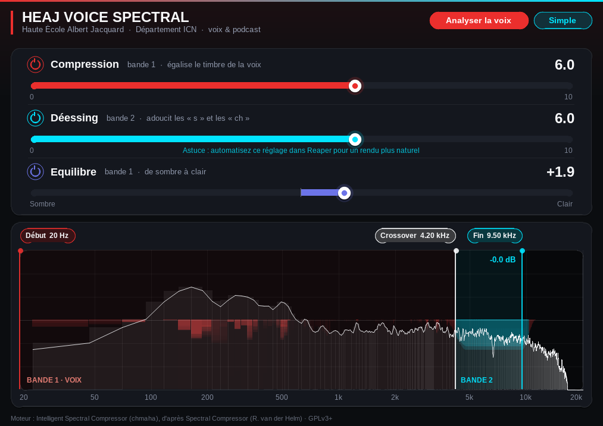
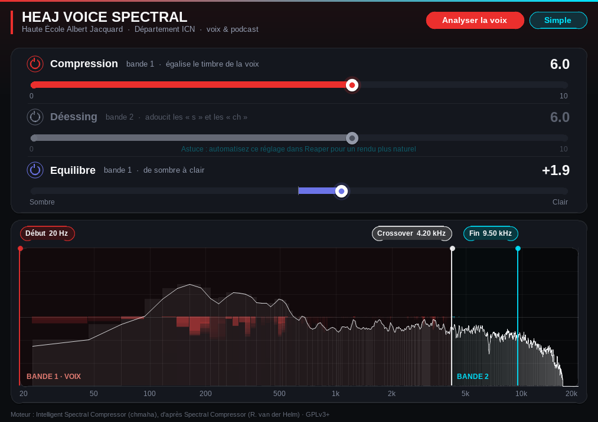
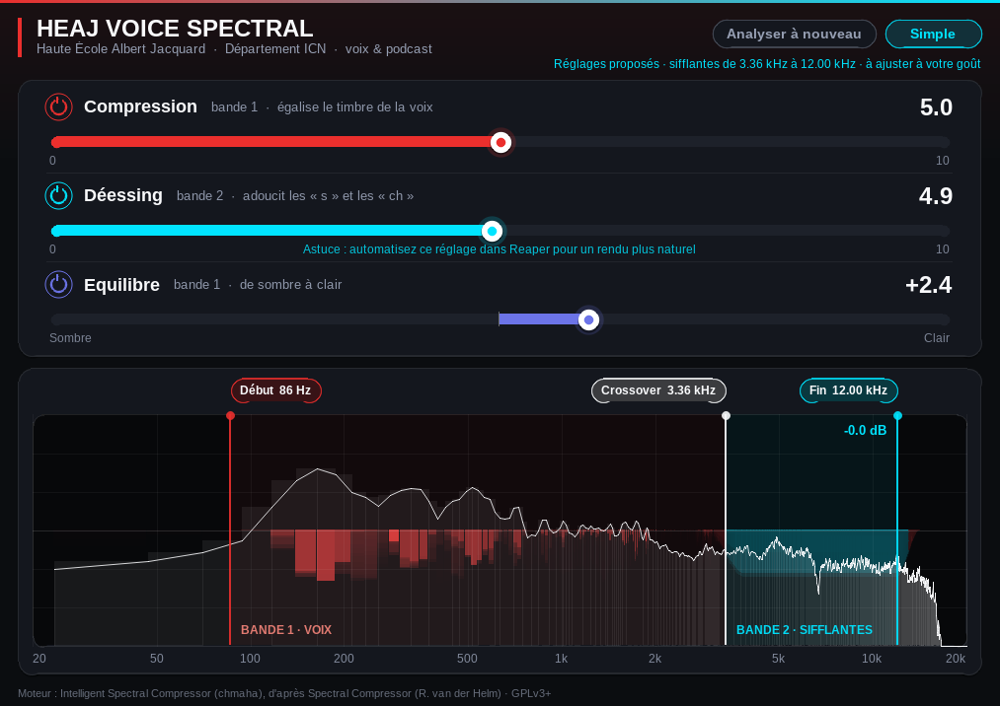
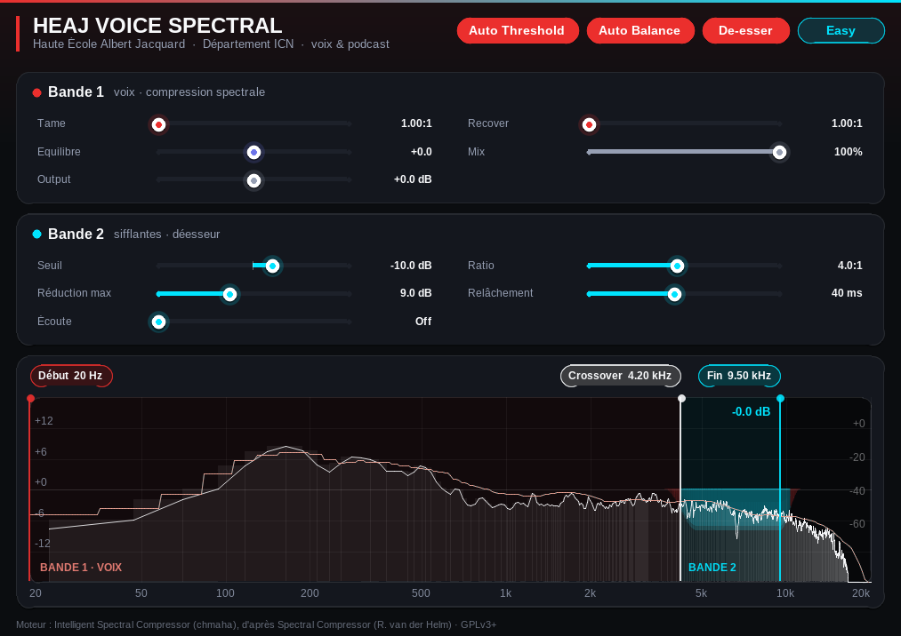

# HEAJ Voice Spectral – trois curseurs pour la voix, avec réglage automatique

Un effet pour Reaper (format JS) aux couleurs de la HEAJ, pensé pour des étudiants qui ne sont pas ingénieurs du son. Dans la vue **Simple** (celle qui s'ouvre par défaut) il y a trois curseurs horizontaux, chacun avec son interrupteur :

- **Compression** (bande 1) : lisse la voix en calmant les fréquences qui « sortent » (résonances, boxiness, proximité du micro). Les écarts de timbre diminuent, sans écraser la voix.
- **Déessing** (bande 2) : atténue les « s » et les « ch » agressifs, seulement au moment où ils dépassent.
- **Equilibre** (bande 1) : fait pencher le timbre vers le sombre ou le clair (plus on monte, plus les aigus sont épargnés par la compression).

Le petit **interrupteur rond** à gauche de chaque curseur met ce réglage en bypass, pour comparer avec et sans. Les curseurs vont de 0 à 10 (Equilibre de −12 à +12) ; à 0, l'effet ne change rien au son. **Le moins possible : on règle à l'oreille, au casque.**

Sous les trois curseurs, le graphique du spectre permet de tirer **trois poignées** à la souris : le **début de la bande 1**, le **crossover** (là où la bande 1 s'arrête et où la bande 2 commence) et la **fin de la bande 2**. Un double-clic sur une poignée (ou sur un curseur) la remet à sa valeur d'origine (20 Hz, 4,2 kHz, 9,5 kHz).

Basé sur « Intelligent Spectral Compressor » de chmaha, lui-même un portage de Spectral Compressor (Robbert van der Helm). Licence GPLv3+, comme les originaux.

---

## Pour les étudiants : installation (une seule fois)

1. **Installer ReaPack** : [reapack.com](https://reapack.com), si ce n'est pas déjà fait.
2. Dans Reaper : *Extensions → ReaPack → Import repositories…* puis coller l'adresse :

   `https://raw.githubusercontent.com/VOTRE-COMPTE/heaj-voice-spectral/main/index.xml`

3. *Extensions → ReaPack → Synchronize packages*.
4. *Extensions → ReaPack → Browse packages…*, chercher « HEAJ », clic droit sur **heaj_voice_spectral** → *Install*, puis valider.
5. Sur la piste de voix, cliquer sur le bouton **FX** et chercher « HEAJ Voice Spectral ».

Sans ReaPack : copier le fichier `Effects/HEAJ/heaj_voice_spectral` dans le dossier `Effects` de Reaper (*Options → Show REAPER resource path in explorer/finder*).

## Réglage automatique : « Analyser la voix »

En vue Simple, le bouton rouge **Analyser la voix** (en haut à droite) propose un réglage de départ adapté à la voix enregistrée :

1. Lancez la lecture sur un passage où la personne parle (environ 10 secondes, sans musique).
2. Cliquez sur **Analyser la voix**. Une barre de progression avance pendant l'écoute ; on peut cliquer à nouveau pour terminer plus tôt (3 secondes minimum).
3. À la fin, le plugin place lui-même **Compression**, **Déessing**, **Equilibre**, le **début de la bande 1**, le **crossover** et la **fin de la bande 2**, et active les trois interrupteurs. Ensuite, on ajuste à l'oreille comme d'habitude.

Ce que l'analyse mesure : le spectre moyen de la voix (hors silences), la zone où les « s » ressortent par rapport au reste de la voix (elle donne le crossover et la fin de la bande 2), leur force (elle donne le Déessing), la pente générale clair/sombre de la voix (elle donne Equilibre), la fréquence la plus grave de la voix (elle donne le début de la bande 1) et l'irrégularité du spectre (elle donne la Compression, entre 3,5 et 6,5 seulement). Rien ne bouge tant qu'on ne clique pas : une fois posé, le réglage reste stable.

## Conseil : automatiser le Déessing

Pour un rendu plus naturel, **automatisez le curseur Déessing** plutôt que de le laisser fixe : les « s » ne sont pas aussi marqués d'un bout à l'autre d'une prise, et un réglage fixe finit par trop agir sur les passages calmes ou pas assez sur les passages agressifs. Le plugin le rappelle sous le curseur (« Astuce : automatisez ce réglage… »).

Dans Reaper, le réglage s'appelle **De-ess (Simple)** dans la liste des paramètres du plugin : ouvrez le bouton **Param** de la fenêtre FX pour en faire une enveloppe d'automation, puis dessinez-la (ou enregistrez-la en mode *Touch*/*Latch* en bougeant le curseur pendant la lecture). L'analyse automatique donne le niveau moyen de départ ; l'enveloppe le baisse sur les phrases peu sifflantes et le remonte là où les « s » piquent.

## Utilisation

1. Placez l'effet sur la piste de voix et lancez la lecture.
2. Poussez le curseur **Compression** jusqu'à ce que la voix paraisse plus régulière, puis arrêtez-vous avant qu'elle sonne « étouffée ».
3. Poussez le curseur **Déessing** jusqu'à ce que les « s » ne piquent plus, puis arrêtez-vous avant que la voix zézaie.
4. Si la voix est trop sombre ou trop claire, ajustez **Equilibre**.
5. Comparez avec et sans, soit avec les interrupteurs ronds de chaque carte, soit avec le bypass du FX.

Un décalage d'environ 45 ms est introduit par l'effet. Reaper le compense automatiquement.

Raccourcis : on peut cliquer n'importe où sur la piste d'un curseur pour y aller directement ; double-clic = valeur d'origine ; molette de la souris = réglage fin.

---

## Les deux bandes

| | Bande 1 : la voix | Bande 2 : les sifflantes |
|---|---|---|
| Zone | du **début de bande 1** (20 Hz par défaut) jusqu'au **crossover** | du **crossover** jusqu'à la **fin de bande 2** (9,5 kHz par défaut) |
| Traitement | compresseur spectral du plugin d'origine : chaque fréquence est comparée à la forme moyenne du spectre de la voix, et ramenée vers elle si elle dépasse | déesseur : compare l'énergie des aigus à celle du corps de la voix (200 à 2500 Hz) |
| Pourquoi c'est fiable | les seuils sont automatiques | la mesure est **relative** : elle ne dépend pas du niveau d'enregistrement, donc pas de réglage différent selon la distance au micro |

Le **crossover** est unique : la bande 1 s'arrête là où la bande 2 commence (fondu de ±0,2 octave autour de la fréquence), les deux bandes ne se recouvrent donc jamais. Les poignées se bloquent mutuellement : il reste toujours au moins un facteur 1,5 (environ une demi-octave) entre deux d'entre elles.

Dans la vue Simple, le curseur **Compression** règle le ratio de la bande 1 (de 1:1 à environ 4,6:1) et un petit gain de compensation. le curseur **Déessing** règle le seuil, le ratio et la réduction maximale (de 3 à 12 dB) de la bande 2, qui ne travaille pas pendant les pauses, pour ne pas faire « respirer » le bruit de fond.

## Les vues *Easy* et *Advanced* (pour l'enseignant)

Le bouton en haut à droite change de vue : *Simple → Easy → Advanced*.

- **Easy** : curseurs de la bande 1 : *Tame*, *Recover*, **Equilibre**, *Mix*, *Output*. Bande 2 avec *Seuil*, *Ratio*, *Réduction max*, *Relâchement*, *Écoute*. Les trois poignées de fréquence sont aussi sur le graphique.
- **Advanced** : tous les réglages du plugin d'origine, plus ceux de la bande 2, le début de la bande 1, le crossover et la fin de la bande 2.
- **Écoute** (« Retiré ») fait entendre uniquement ce que le déesseur retire : pratique pour trouver la bonne zone.
- Les réglages de la vue Simple (curseurs, interrupteurs) ne pilotent que cette vue. Les trois fréquences, elles, sont communes aux trois vues, et l'analyse les modifie.

---

## Tests effectués et limites

- Testé hors ligne sur une prise de voix réelle (11 s, 48 kHz) : tout à 0 ou tous les interrupteurs coupés, le son ressort identique à l'entrée ; le déesseur réduit les « s » détectés d'environ 3,6 dB à 5, 7,5 dB à 10, et ne touche pas le reste ; la bande 1 n'agit plus au-dessus du crossover ; Equilibre et début de bande 1 déplacent bien l'effet ; sorties valides à 44,1 / 48 / 96 kHz et avec d'autres tailles de fenêtre.
- L'interface a été **affichée et manipulée** dans un lecteur de test (les trois vues, le glisser des curseurs et des trois poignées, les interrupteurs, le changement de vue, deux tailles de fenêtre), mais **pas dans Reaper lui-même** cette fois : les polices et les accents peuvent différer légèrement. Les curseurs sont dessinés avec des formes simples et lissées, et l'affichage a été allégé pour rester fluide pendant le glissé ; dites-moi ce que vous voyez dans Reaper.
- **L'analyse automatique** a été testée sur la prise de test et sur des variantes fabriquées à partir d'elle (voix plus sombre, plus claire, sifflantes plus agressives, résonance à 300 Hz, voix transposée de ±4 demi-tons) : les réglages proposés bougent dans le bon sens (par exemple Equilibre monte quand la voix est plus sombre, le Déessing monte quand les « s » sont plus forts, le crossover suit la hauteur de la voix). Les valeurs fixes de référence (pente « normale », niveau « normal » des « s ») viennent de cette seule voix et restent à affiner sur d'autres voix. La **Compression** est l'estimation la plus fragile (bornée entre 3,5 et 6,5), et le **Déessing** dépend de la présence de vrais « s » dans l'extrait : un extrait trop court ou sans sifflantes donnera un Déessing bas. L'analyse n'a pas été essayée dans Reaper.
- **Pas encore écouté sur d'autres voix.** Le réglage est calé sur une voix masculine ; les voix plus aiguës peuvent demander d'ajuster la bande 2 en vue Easy.
- La compression ajoute un petit gain de compensation (jusqu'à environ 4 dB) à tout le signal ; coupez l'interrupteur de Compression pour l'enlever.
- C'est une approche du même principe que les outils commerciaux de suppression de résonances, pas une copie : à valider à l'oreille avant le cours.

## Pour l'enseignant : publier le dépôt

1. Créer un dépôt GitHub **public** (par exemple `heaj-voice-spectral`) et y pousser le contenu de ce dossier.
2. Générer l'index : `python3 build_index.py VOTRE-COMPTE heaj-voice-spectral main`, puis commit + push de `index.xml`.
3. Donner aux étudiants l'adresse de `index.xml` (étape 2 ci-dessus, avec votre compte).
4. À chaque mise à jour : augmenter `version:` dans l'en-tête de l'effet, relancer `build_index.py`, commit + push.

Le dossier `demo` contient des extraits de la prise de test : l'original, deux réglages Simple, le déesseur seul, ce que le déesseur retire, et le réglage proposé par l'analyse automatique. Le dossier `docs` contient des captures des vues.
